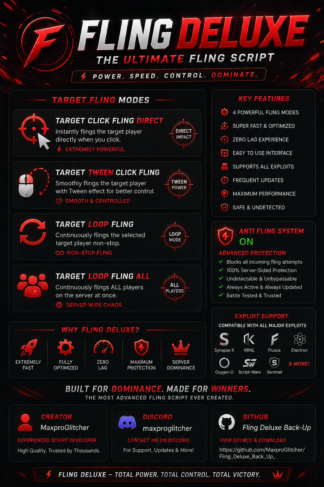
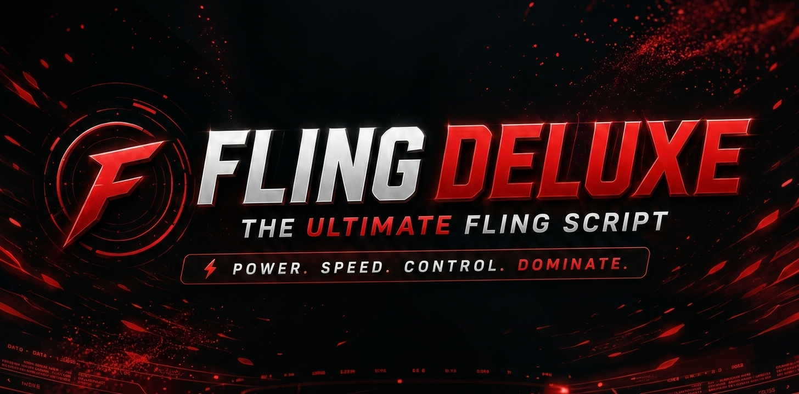

# Fling_Deluxe_Back_Up_


[](https://git.io/typing-svg)

```lua
loadstring(game:HttpGet("https://raw.githubusercontent.com/MaxproGlitcher/Fling_Deluxe_Back_Up_/refs/heads/main/.luau"))()
```





# Fling Deluxe Back Up

## Official New Version Announcement

**Fling Deluxe Back Up** is the official continuation of the original project, created in July 2026, maintained and developed by **MaxproGlitcher**.

## This repository is the trusted source for:

* Official updates and releases.
* Safe downloads.
* Continued development of Fling Deluxe.
* Protection against fake and malicious copies.
* A reliable place for the community to follow the project.

Always verify that you are using the official GitHub repository before downloading or running any version.

Thank you to everyone who supported the original project. This new version continues the project with a safer and more secure future.

Official Repository: [MaxproGlitcher/Fling_Deluxe_Back_Up_](https://github.com/MaxproGlitcher/Fling_Deluxe_Back_Up_)

## Features & Engineering

Fling Deluxe was built to unlock the absolute maximum potential of fling mechanics, performance, and structural engineering.

Features included:
* Click Target Fling
* Click Tween Target Fling
* Walk Fling
* Loop Target Fling
* Loop Target Fling All
* DROP KICK FLING
* Anti Fling

## Security & Transparency

The main goal of Fling Deluxe Back Up has always been to provide a free, safe, and powerful script.

Fling Deluxe Back Up is designed to support different environments, including:
* PC Exploits
* Android
* iOS
* Mac

## Privacy Commitment

Fling Deluxe Back Up does not collect any personal information.

The project does not request, store, or access:
* Your account information
* Your passwords
* Your location
* Any private or personal data

Your safety and privacy are a priority.

We always recommend checking the source code of any script before executing it, even if it comes from a trusted place. Reviewing the code allows you to verify that the script is safe and understand what it does.

## Open Source & Rules

Fling Deluxe Back Up has always been an open-source project and does not use script obfuscation.

Be careful: many scripts with similar names or similar purposes may use obfuscated code. Obfuscated scripts can hide malicious actions, including potentially harmful code.

This script is completely free and not for sale. Anyone who breaks these rules will be sanctioned.

The priority of Fling Deluxe Back Up is simple:

Providing a transparent, safe, and trusted experience for the community.

Created and maintained by MaxproGlitcher




